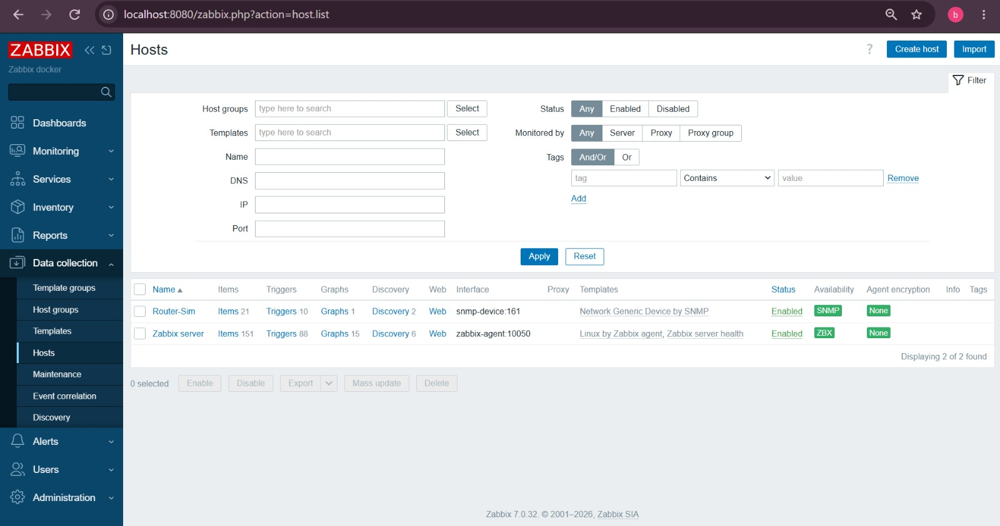
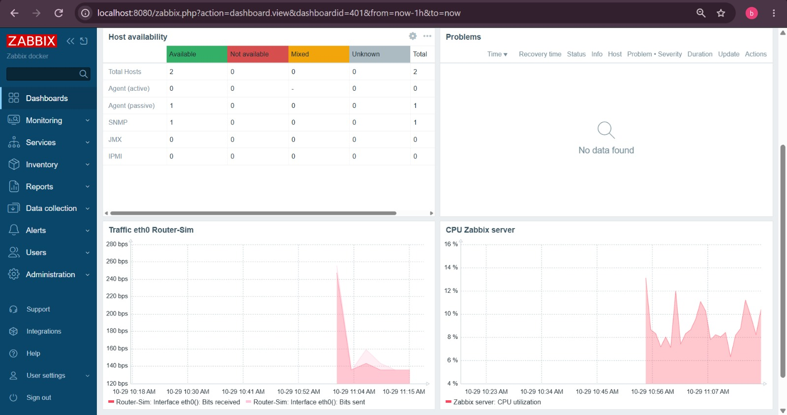
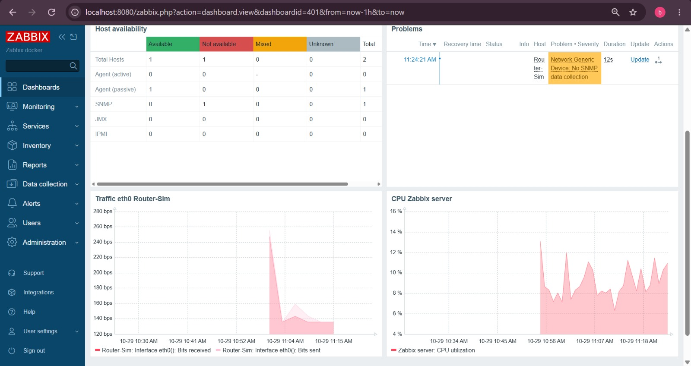
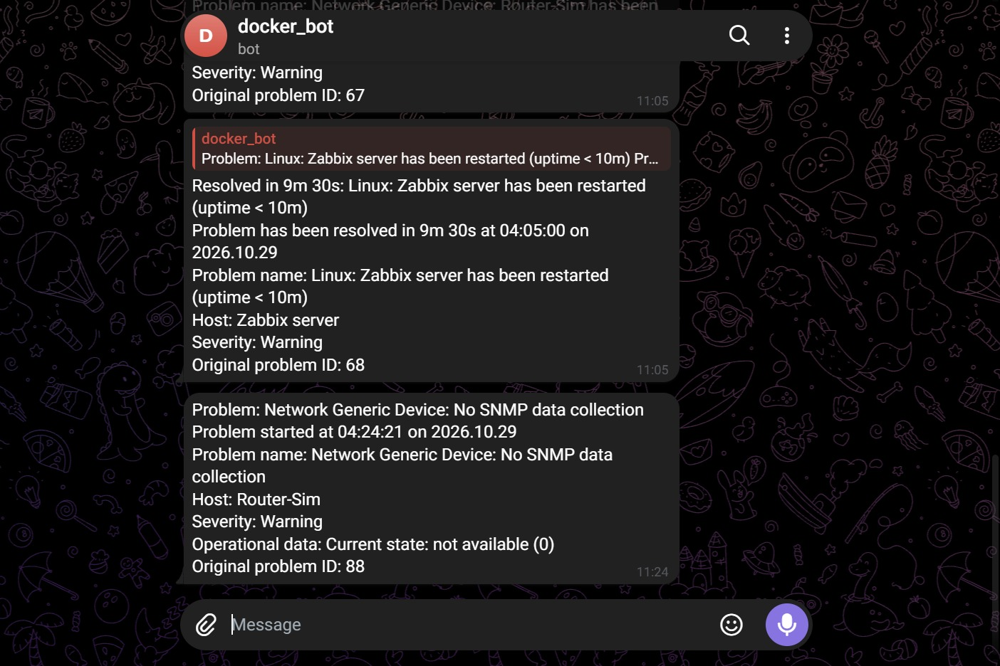
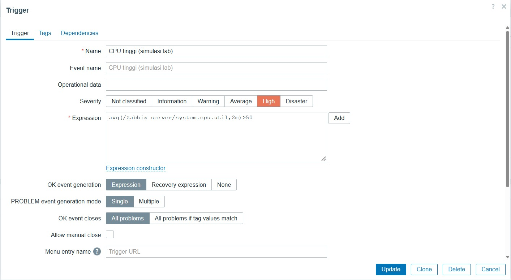
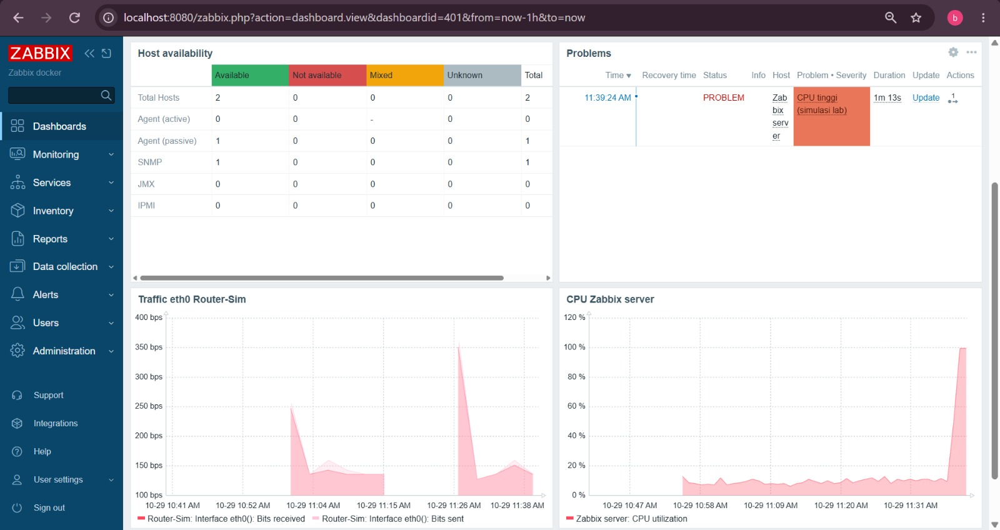

# Zabbix Network Monitoring Lab

Lab monitoring jaringan memakai Zabbix 7.0 yang berjalan di Docker, lengkap dengan dashboard dan notifikasi alert ke Telegram. Project ini dibuat sebagai portofolio untuk posisi NOC dan Data Center.

## Tujuan

- Memahami alur kerja monitoring: pengumpulan data, penilaian lewat trigger, lalu notifikasi.
- Memantau dua jenis perangkat, yaitu server Linux lewat Zabbix agent dan perangkat jaringan lewat SNMP.
- Mensimulasikan gangguan, lalu mencatat berapa lama alert muncul dan bagaimana pemulihannya.

## Arsitektur

Semua komponen berjalan sebagai container Docker di Ubuntu (WSL 2) pada laptop Windows.

- **MySQL 8.0**: database penyimpan konfigurasi dan data hasil pengukuran.
- **Zabbix server**: mengumpulkan data dan menilai trigger.
- **Zabbix web (nginx)**: tampilan di browser, diakses lewat `http://localhost:8080`.
- **Zabbix agent**: memantau kondisi host Zabbix server itu sendiri (CPU, memori, dan lainnya).
- **snmp-device**: container kecil berisi `snmpd` yang berperan sebagai perangkat jaringan tiruan bernama Router-Sim, dipantau lewat SNMP v2c dengan template Network Generic Device by SNMP.
- **Telegram bot**: media type webhook untuk mengirim pesan Problem dan Resolved.

## Cara menjalankan

1. Pastikan Docker Engine sudah terpasang dan berjalan.
2. Jalankan `docker compose up -d --build` di folder project.
3. Tunggu sekitar 3 sampai 5 menit saat pertama kali, karena database perlu menyiapkan tabelnya.
4. Buka `http://localhost:8080` dan login dengan `Admin` / `zabbix`.
5. Tambahkan host Router-Sim dengan interface SNMP ke DNS `snmp-device` port 161, lalu pasang template Network Generic Device by SNMP.
6. Isi token bot di Alerts > Media types > Telegram, daftarkan chat ID di tab Media milik user, lalu aktifkan action bawaan Report problems to Zabbix administrators.

## Hasil

### Daftar host

### Dashboard NOC Overview (kondisi normal)
Dashboard berisi ringkasan ketersediaan host, daftar masalah aktif, grafik trafik eth0 Router-Sim, dan grafik CPU Zabbix server.

## Simulasi gangguan

| Gangguan | Cara simulasi | Waktu sampai alert muncul | Pemulihan |
|---|---|---|---|
| Perangkat SNMP mati | `docker compose stop snmp-device` | sekitar 10 menit (trigger No SNMP data collection, severity Warning) | `docker compose start snmp-device`, pesan Resolved masuk sekitar 3 sampai 5 menit kemudian |
| CPU tinggi | menjalankan proses `yes` di semua inti CPU | kurang dari 5 menit (trigger buatan sendiri, severity High) | `pkill yes`, pesan Resolved masuk sekitar 2 sampai 3 menit kemudian |

### Skenario 1: perangkat SNMP mati
Dashboard saat Router-Sim tidak menjawab:

Notifikasi yang masuk ke Telegram:

### Skenario 2: CPU tinggi
Trigger dibuat sendiri dengan aturan rata-rata CPU di atas 50% selama 2 menit, supaya deteksinya cepat untuk keperluan demo.

Dashboard saat CPU naik:

## Catatan tuning

Trigger No SNMP data collection pada template bawaan menunggu perangkat tidak menjawab sekitar 5 menit (macro `{$SNMP.TIMEOUT}`), ditambah sela waktu antar pengecekan. Jeda ini disengaja untuk menghindari alarm palsu akibat gangguan sesaat. Untuk keperluan demo, nilai macro itu bisa dipersingkat, misalnya menjadi 1m, dengan konsekuensi alarm palsu lebih mudah muncul. Di jaringan produksi, nilai ini perlu disesuaikan dengan karakter perangkat dan kebutuhan respon tim.

## Catatan keamanan

Password database di file konfigurasi hanya untuk lab lokal dan perlu diganti kalau dipakai di luar lab. Token Telegram bot tidak disimpan di repo ini, melainkan diisi langsung lewat tampilan web Zabbix.

## Ide pengembangan

- Menambahkan perangkat nyata seperti MikroTik CHR atau switch lewat SNMP.
- Menambahkan deteksi anomali sederhana pada data trafik.
